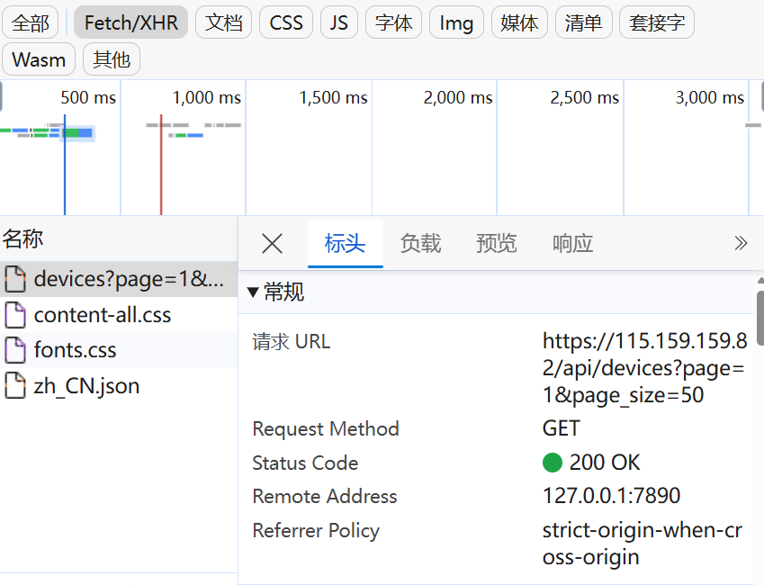
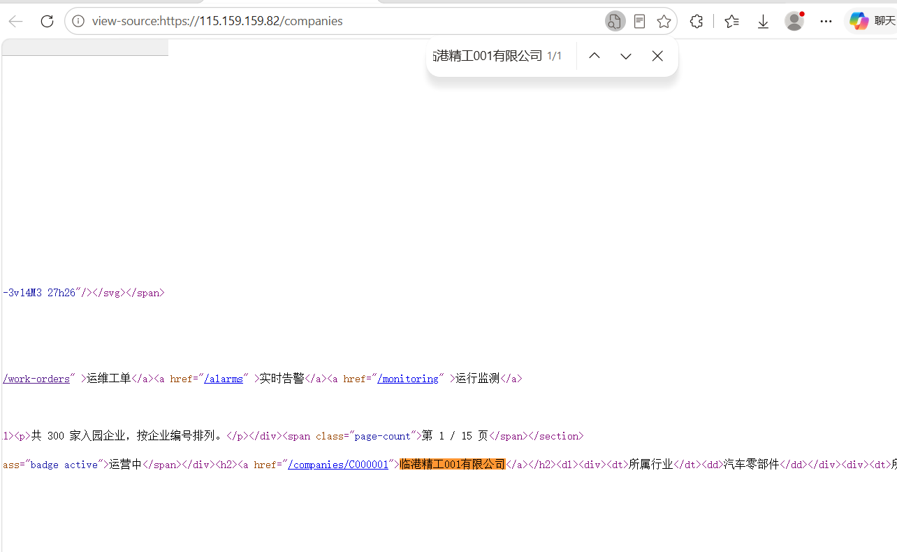
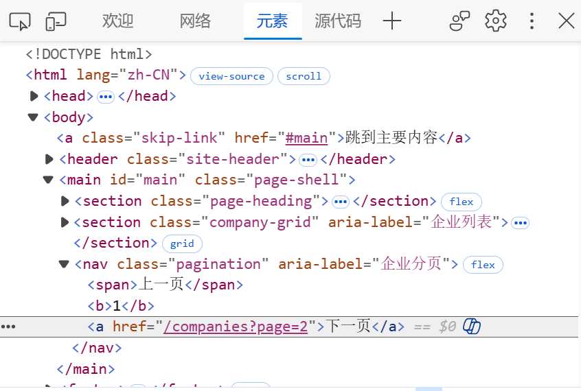
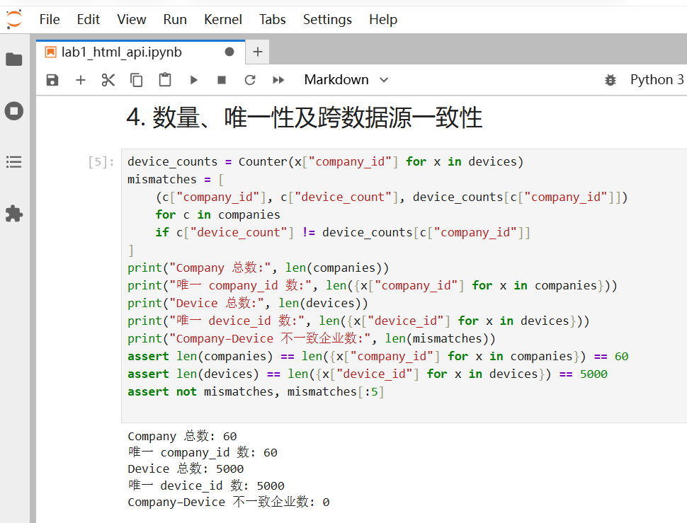

# Lab 1 实验报告

## 学生信息

- **姓名：**陈泓宇
- **学号：**112411160433
- **班级：**数据1241
- **GitHub 用户名：**leojacky66
- **仓库地址：**https://github.com/leojacky66/bigdata-collection-labs-112411160433

> 文件位置：`lab01/REPORT.md`  
> 完整代码保存在 `lab1_html_api.ipynb`。本报告只记录关键发现、关键代码、结果和指定截图。

---

# 任务 1：判断数据加载方式

## 1.1 Device：判断动态加载并找到 API

### 判断结果

- 页面：`/devices`
- 数据加载方式：动态加载
- 判断依据：设备页初始 HTML 中搜索不到第一页实际返回的设备名称“循环泵-000001-001”；设备列表由 `/api/devices` 返回的 JSON 提供，分页请求位于 Network 的 Fetch/XHR 中。

### API 信息

- Request URL：`https://115.159.159.82/api/devices?page=1&page_size=50`
- Request Method：`GET`
- Query 参数：`page=1`、`page_size=50`

### 【截图 1】Device API 发现证据



---

## 1.2 Company：判断静态加载

- 页面：`/companies`
- 数据加载方式：静态加载
- 判断依据：第一页返回的 HTML 中直接包含企业记录，例如“临港精工001有限公司”；无需再请求企业列表 API，就能从 HTML 中解析出本页 20 条记录。浏览器源代码可搜索该企业名称。

### 【截图 2】Company 静态加载证据



---

# 任务 2：Device API 分页采集

## 2.1 API 分页结构

| 含义 | JSON 字段 |
|---|---|
| 当前页 | `page` |
| 每页条数 | `page_size` |
| 设备总数 | `total` |
| 设备列表 | `items` |

## 2.2 关键代码

```python
total = data["total"]
page_size = data["page_size"]
total_pages = (total + page_size - 1) // page_size

devices = []
for page in range(1, total_pages + 1):
    if page == 1:
        page_data = data
    else:
        response = session.get(
            api_url,
            params={"page": page, "page_size": page_size},
            timeout=15,
        )
        response.raise_for_status()
        page_data = response.json()
    devices.extend(page_data["items"])
```

## 2.3 采集结果

- 每页条数：50
- 设备总数：5,000
- 程序计算得到的总页数：100
- 最终采集设备数：5,000
- 唯一 `device_id` 数：5,000

总页数由接口返回的 `total` 和 `page_size` 计算，才能在数据总量或每页条数变化时仍采集完整；写死 100 页可能漏采或请求多余页面。

---

# 任务 3：Company HTML 解析

## 3.1 企业记录 Selector

- 企业记录 selector：`article.company-card`
- 第 1 页企业记录数：20

该写法使用记录最外层的 `article` 标签及语义明确的 `company-card` class，不依赖企业在页面中的位置。参考 AI 提示后，以实际 HTML 解析结果验证：首页恰好匹配 20 条企业记录；没有采用冗长的 Copy selector 路径。

## 3.2 关键代码

```python
cards = soup.select("article.company-card")
card = cards[0]

company_id = card["data-company-id"]
name = card.select_one("h2 a").get_text(strip=True)
status = card.select_one(".badge").get_text(strip=True)

details = {
    item.select_one("dt").get_text(strip=True):
    item.select_one("dd").get_text(strip=True)
    for item in card.select("dl > div")
}
industry = details["所属行业"]
zone = details["所在区域"]
device_count = int(details["设备数量"].split()[0])
```

## 3.3 字段来源说明

1. 字段：`company_id`
   - 来自：HTML 属性
   - 使用的方法：在当前 `article.company-card` 上读取 `data-company-id`。
2. 字段：`device_count`
   - 来自：文本
   - 使用的方法：在当前记录的 `dl > div` 中按 `dt` 标签找到“设备数量”，读取对应 `dd` 文本并转为整数。

---

# 任务 4：Company “下一页”分页

## 4.1 下一页元素

- “下一页” selector：`nav.pagination a:last-child`
- 第 1 页 `href` 示例：`/companies?page=2`

### 【截图 3】Company “下一页”元素



## 4.2 关键代码

```python
next_link = soup.select_one("nav.pagination a:last-child")
assert next_link.get_text(" ", strip=True) == "下一页"
next_href = next_link.get("href")
next_url = urljoin(current_url, next_href)
```

程序请求当前页，解析该页的企业记录，再读取“下一页”链接的 `href`。使用 `urljoin` 将相对路径转为完整 URL，作为下一轮请求地址；循环三次，依次采集第 1～3 页。

## 4.3 三页采集结果

| 页码 | 企业数 |
|---|---:|
| 1 | 20 |
| 2 | 20 |
| 3 | 20 |
| **合计** | **60** |

- 唯一 `company_id` 数：60

---

# 任务 5：结果验证

## 5.1 最终结果

| 检查项 | 结果 |
|---|---:|
| Company 总数 | 60 |
| 唯一 `company_id` | 60 |
| Device 总数 | 5,000 |
| 唯一 `device_id` | 5,000 |
| Company–Device 不一致企业数 | 0 |

### 【截图 4】最终验证结果



## 5.2 一致性检查关键代码

```python
from collections import Counter

device_counts = Counter(x["company_id"] for x in devices)
mismatch_count = 0

for company in companies:
    cid = company["company_id"]
    expected = company["device_count"]
    actual = device_counts[cid]
    if expected != actual:
        mismatch_count += 1
```

`status_code == 200` 只说明请求成功返回，不能保证所有分页都抓全，也不能保证解析字段正确或没有重复记录。因此还检查总量、ID 唯一性及企业设备数与设备表的对应关系。

---

# 任务 6：保存采集结果

- `companies.json`：已生成（`data/companies.json`，60 条）
- `devices.json`：已生成（`data/devices.json`，5,000 条）

---

# 实验结论

设备页通过 API 动态加载数据，企业页则可直接解析初始 HTML。设备分页依据总数和每页条数计算页数，企业分页沿“下一页”链接前进。实验采集设备 5000 条、企业 60 条，并通过总量、ID 唯一性和企业设备数一致性检查，最后保存为 JSON。
