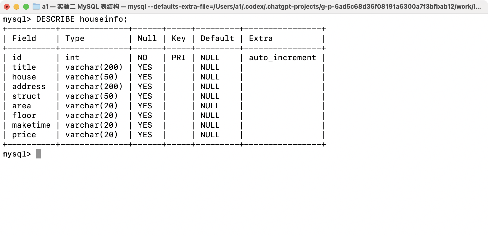
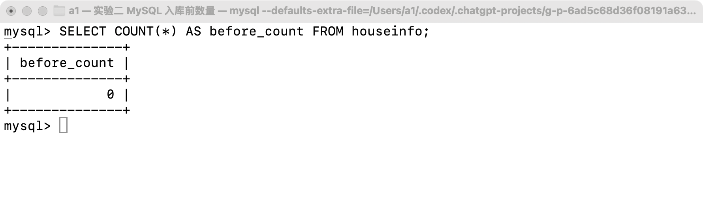
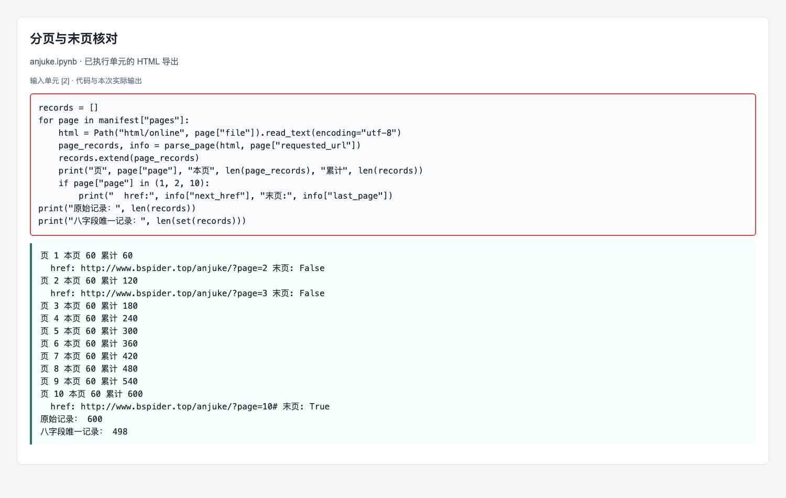
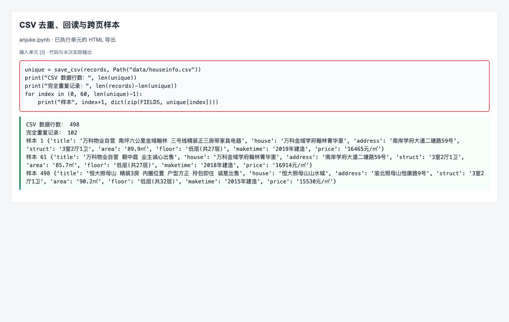
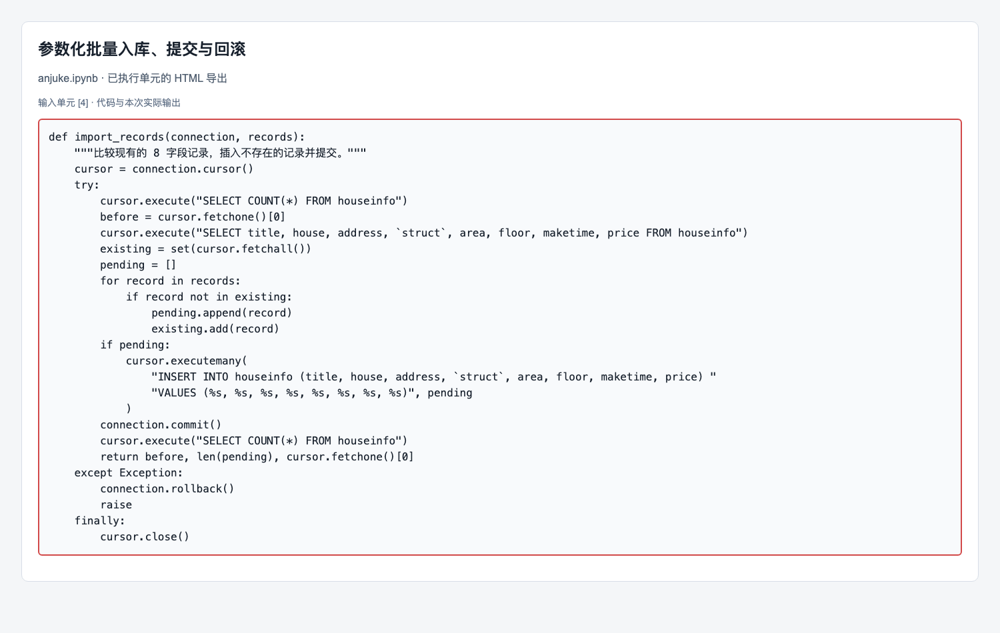
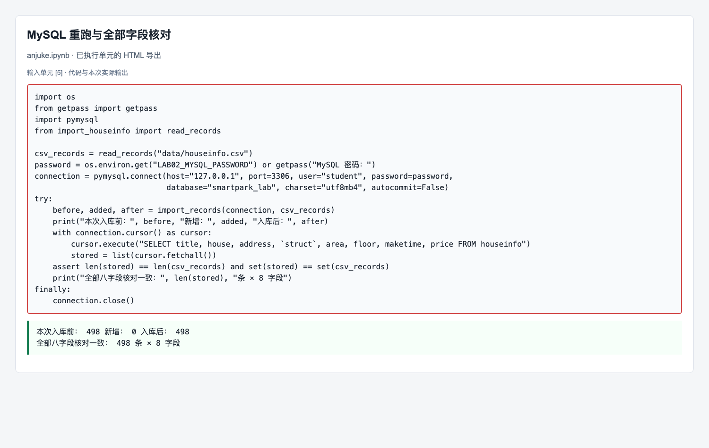

# 实验二报告：房源采集与 MySQL 存储

- 班级：数据1241
- 姓名：陈泓宇
- 学号：112411160433
- 实验日期：2026-10-27
- GitHub 仓库链接：https://github.com/leojacky66/bigdata-collection-labs-112411160433
- 源码文件名：`anjuke.ipynb`、`collect_houseinfo.py`、`fetch_firecrawl.py`、`import_houseinfo.py`
- 数据库与表：`smartpark_lab.houseinfo`
- 数据来源：在线教学站 `http://www.bspider.top/anjuke/`，通过 Firecrawl 实际访问并取得第1—10页 HTML。
- 访问时间及结果：2026-10-27（北京时间），实际在线请求记录见 `data/collection_summary.json`；每页成功解析60条，第10页确认禁用的下一页按钮后停止。
- 本次在线响应归档：`html/online/page_01.html` 至 `html/online/page_10.html`，对应原始响应和校验信息另随程序输出保存。
- 快照文件来源：前期曾解析用户保存的第1、2、4、7页，数据库累计236条；本次最终 CSV 来自完整10页在线响应，不混入残缺或页码未确认的用户文件。

本次完成10页在线采集、CSV保存及回读、MySQL入库和独立重跑验证。原始600条房源按八字段完全相同去重，得到498条，CSV和MySQL中的498条记录全部核对一致。浏览器 Copy selector 操作、部分代码框选与运行结果界面截图尚未完成，报告未将这些操作记为已完成。

## 第一阶段：MySQL 更新与启动

- 本次是否需要更新：使用 Mac 本机已有的 MySQL 8.4.11；未执行教师提供的 Windows Docker 更新脚本。
- 更新或启动遇到的问题：教师启动文件为 Windows `.bat`，本次使用本机 MySQL 和 JupyterLab 完成对应的连接、建库、建表及查询。

### 启动环境与建表

数据库地址为 `127.0.0.1:3306`，数据库为 `smartpark_lab`。按教师SQL建立 `houseinfo`，保留已有数据库和其他数据；第一阶段实际查询房源表为0条，后续各批均采用新增方式写入。

`id` 保存自增长主键，用于区分数据库记录。其余八个字段依次保存房源标题、楼盘名称、地址、户型、面积、楼层、建造年代和每平方米单价；`id` 不参加房源八字段去重。

## 第二阶段：房源采集与 CSV 数据存储

### 1. 网页分析与房源解析

#### 选择器是怎样得到的

- 选择的字段：房源标题 `title`。
- 浏览器复制的原始选择器：尚未完成 Elements → Copy selector 操作，未填写未经实际复制的选择器。
- 一条房源的父容器选择器：`div.property`。
- 最终使用的相对选择器：`h3`。

程序先用 `soup.select("div.property")` 找出房源父容器，再在每个容器中调用 `select_one("h3")` 获取标题。实际在线10页均匹配60个父容器，每个容器内可以对应一组标题、楼盘、地址、属性和价格；当前选择器依据已保存的实际 HTML 核验，尚缺浏览器节点框选及匹配结果截图。

#### 解析8个字段

| 字段 | 含义 | 相对选择器或定位方法 |
|---|---|---|
| title | 房源标题 | `h3` |
| house | 楼盘或小区名称 | `.property-content-info-comm-name` |
| address | 小区地址 | `.property-content-info-comm-address` |
| struct | 户型 | `.property-content-info-attribute` |
| area | 面积 | 属性组中匹配面积数字与 `㎡` 等单位的文字 |
| floor | 楼层 | 属性组中包含“层”的项 |
| maketime | 建造年代 | 属性组中包含“年建造”的项，缺失时为空字符串 |
| price | 每平方米单价 | `.property-price-average`，校验含“元/”单位 |

`select()` 返回所有匹配的节点，适合获取一页房源或一条房源中的属性列表。`select_one()` 返回首个匹配节点，适合读取单条房源的标题、楼盘、地址、户型和单价。

面积通过单位和数字模式定位，楼层通过“层”识别，避免节点顺序改变后把朝向当成楼层。单价取自 `.property-price-average`，例如首条为 `16465元/㎡`，不使用旁边以“万”为单位的总价；面积保留 `89.9㎡`，年代保留 `2019年建造`。地址使用节点原有文字顺序，未在相邻子标签间额外添加空格。

首条房源的八字段输出，以及跨页、末条样本，见第三阶段逐条核对表。解析代码及实际输出保存在源码和 Notebook 中；本节要求的代码红框、面积及单价HTML节点界面截图尚待补充。

### 2. 下一页采集

- 第一页下一页 `href`（本次 Firecrawl 在线响应）：`http://www.bspider.top/anjuke/?page=2`。前期用户保存页面中的相对原值为 `?page=2`。
- `urljoin()` 补全地址：`http://www.bspider.top/anjuke/?page=2`。
- 实际停止原因：第10页的下一页按钮没有 `next-active`，链接为本页地址加 `#`，确认禁用后正常停止。

`fetch_firecrawl.py` 取得实际在线响应，`parse_page()` 解析房源和下一页链接；下一轮地址由当前页面的 `href` 经 `urljoin()` 得到。程序限制下一页仍在教学站范围内，记录已访问URL及整页记录特征，遇到重复URL、重复整页、验证页、空房源或异常分页便报错，避免无限循环。

后续页面请求前等待至少1秒。第10页的链接被采集服务补成 `http://www.bspider.top/anjuke/?page=10#`，代码将它识别为指向当前页的空片段链接，并同时检查按钮禁用状态；只看到缺失链接或解析错误时不会误报末页。

| 页面 | 实际房源节点数 | 页内八字段唯一记录数 | 下一页 / 状态 |
|---|---:|---:|---|
| 1 | 60 | 60 | 第2页 |
| 2 | 60 | 59 | 第3页 |
| 3 | 60 | 59 | 第4页 |
| 4 | 60 | 60 | 第5页 |
| 5 | 60 | 60 | 第6页 |
| 6 | 60 | 57 | 第7页 |
| 7 | 60 | 59 | 第8页 |
| 8 | 60 | 56 | 第9页 |
| 9 | 60 | 56 | 第10页 |
| 10 | 60 | 60 | 按钮禁用，正常停止 |

完整逐页请求、文件摘要、下一页和末页判断保存在 `data/collection_summary.json`。第1页复用先前已成功取得的实际在线响应，第2—10页按链接继续请求；程序最终确认10页完整，不把失败重试次数当作成功采集页数。本节流程与日志已取得，教师要求的代码红框及最终停止提示界面截图仍待补充。

### 3. 保存 CSV

使用 `csv.writer` 写入 `data/houseinfo.csv`，编码为 `utf-8-sig`，文件参数为 `newline=""`。表头固定为 `title, house, address, struct, area, floor, maketime, price`，每条房源按照同一顺序写入。

10页共解析600条记录，八字段完全相同的记录重复102次，去重后保存498条数据行。回读时使用 `csv.DictReader` 核对表头和每条记录的八字段内容，结果与写入前一致；同一楼盘中户型、面积或其他字段不同的房源仍保留。

CSV保存及回读的代码与实际条数输出已保存。编码、表头和数据写入部分的代码框选截图尚待补充。

## 第三阶段：MySQL 数据存储

### 1. 读取 CSV 并入库

本阶段读取第二阶段的 `data/houseinfo.csv`，不重新请求网页。`read_records()` 检查八列的表头和字段，按固定字段顺序生成八元素元组，使每条记录与SQL中八个 `%s` 参数位置对应。

`import_records()` 先查询数据库已有的八字段组合，把CSV中尚不存在的组合加入待插入列表，再用 `executemany()` 参数化批量写入。房源文字通过参数传递，未拼接进SQL；成功后调用 `commit()`，异常时调用 `rollback()`，最后关闭游标和连接。

重复检查同时覆盖CSV内部和数据库已有记录，本次498条中已有236条，因此只新增262条。关闭连接后重新启动入库程序，同批CSV新增0条，数据库仍为498条；密码从环境变量或交互输入读取，源码和Notebook不保存密码。

读取CSV、参数整理、防重复、事务处理及关闭资源的代码已保存；对应红框截图尚待补充。

### 2. 核对结果

#### 查询条数和样本

| 项目 | 实际结果 |
|---|---|
| 成功在线采集页数 | 10 |
| 采集记录数（去重前） | 600 |
| 完全相同的重复记录数 | 102 |
| CSV数据行数（不含表头） | 498 |
| 第一阶段建表后、任何房源入库前条数 | 0 |
| 本次完整在线批次入库前条数 | 236（此前用户页面已经入库） |
| 本次入库后条数 / 本次新增条数 | 498 / 262 |
| 关闭连接后，同批数据独立重跑条数 / 新增条数 | 498 / 0 |
| CSV与MySQL的八字段核对 | 数量和记录集合均一致，498条全部匹配 |
| 是否采集完整；未完成的原因 | 本次教学站10页已采集完整；部分过程截图仍未补齐 |

入库前236条来自前期用户提供的第1、2、4、7页，这些记录均包含在最终在线取得的498条中。本次追加262条，未清空或覆盖原记录，完成后数据库总条数与最终CSV数据行数相等。

核对时同时比较记录数量和八字段元组集合，避免只检查总数而漏掉重复或字段错位。实际导入、独立重跑、全字段核对及样本结果保存在 `data/import_verification.json`；MySQL终端中的前后条数、重跑条数和 `SELECT ... LIMIT 5` 界面截图尚待补充。

#### 逐条核对

- 样本1：第1页，最终CSV第1条。
- 样本2：第2页，最终CSV第61条，为跨页样本。
- 样本3：第10页，最终CSV第498条，为最后一条唯一记录。

| 字段 | 样本1 | 样本2 | 样本3 |
|---|---|---|---|
| title | 万科物业自营 南坪六公里金域翰林 三号线精装正三房带家具电器 | 万科物业自营 朝中庭 业主诚心出售 | 恒大照母山 精装3房 内圈位置 户型方正 拎包即住 诚意出售 |
| house | 万科金域学府翰林菁华里 | 万科金域学府翰林菁华里 | 恒大照母山山水城 |
| address | 南岸学府大道二塘路59号 | 南岸学府大道二塘路59号 | 渝北照母山恒康路9号 |
| struct | 3室2厅1卫 | 3室2厅1卫 | 3室2厅1卫 |
| area | 89.9㎡ | 85.7㎡ | 90.2㎡ |
| floor | 低层(共27层) | 低层(共27层) | 低层(共32层) |
| maketime | 2019年建造 | 2018年建造 | 2015年建造 |
| price | 16465元/㎡ | 16914元/㎡ | 15530元/㎡ |

三条样本的在线响应HTML、CSV和MySQL八字段内容均一致。全部498条也通过数量与字段集合核对；面积、单价和年代的对照结果框选截图尚待补充。

## 问题与解决

- 初期使用本机 `requests` 得到HTTP 200但页面标题是“访问验证-安居客”，未取得房源，不能凭状态码判断采集成功。之后通过Firecrawl实际访问同一教学站，取得全部10页房源并逐页归档，最终在线采集已成功。
- 用户提供的部分文件有重复粘贴、页码与内容不符或截断：声称第3页的文件八字段与第一页相同，第5页文件只有2个节点、其中1条完整且没有分页。这些文件未作为完整在线结果混入最终CSV。
- 采集服务会把末页的 `#` 补成当前页的绝对URL。程序结合按钮禁用状态和去除片段后的URL判断末页，修正后在第10页正常停止。
- 尚未完成：浏览器Copy selector实际操作截图，以及教师要求的部分代码红框、运行过程和MySQL终端核对截图。当前不声称已满足全部截图验收项。

## 思考题

1. 本次怎样实现下一页采集？结合自己的代码说明。

   答：每页先读取下一页按钮的 `href`，再用 `urljoin(current_url, href)` 得到完整地址，并更新下一轮请求URL。本次实际依次取得第1—10页；第10页按钮禁用且链接指回本页片段，程序据此正常停止。

2. 旧代码把 out_list 定义在全局。你把结果列表放在哪里？为什么？

   答：将结果列表放在采集函数内部，调用时创建本轮的新列表。这样反复执行不会把上一轮记录继续累计，函数返回的结果也便于单独核对、去重和保存。

3. 你怎样获取建造年代？节点缺失或顺序改变时，怎样处理？

   答：遍历房源属性文字，查找包含“年建造”的项，找到后保存原文，缺失时保存空字符串。判断依据是文字含义而非固定下标，节点顺序改变时不会把朝向或楼层误作年代。

## 提交检查

- [x] 本地已有源码、在线10页HTML、CSV、报告和第一阶段两张真实截图。
- [x] 10页在线采集完整，已记录末页停止原因和逐页请求信息。
- [x] 498条房源已正式入库，独立重跑新增0条，全部八字段核对一致。
- [ ] 教师要求的Copy selector、代码框选和全部运行结果截图已补齐。
- [ ] 实验一原仓库的 `lab02/` 已上传，并检查GitHub上的文件和图片。

AI使用说明：AI协助编写网页解析、CSV、入库和在线访问代码，执行运行检查并整理报告。实际输出及响应文件随实验保存；学生仍需核对代码解释、截图缺项与教师验收要求，不把AI整理文字视为本人完成了尚未执行的界面操作。

## 已执行 Notebook 的导出截图

以下4张图由实际执行单元的代码与输出导出为HTML后渲染，已核对内容。它们不是IDE或MySQL终端界面截图；此前说明的浏览器Copy selector操作图和第三阶段终端图仍未补齐。

