# 实验三报告｜QQ 邮箱采集（Playwright 版）

| 项目 | 实验记录 |
|---|---|
| 班级、姓名、学号 | 数据1241　陈泓宇　112411160433 |
| 实验日期 | 2026 年 11 月 20 日（第 1—2、3—4、5—6、7—8 课时） |
| 环境 | Windows 上的 Docker Desktop，课程 Linux 容器中的 JupyterLab，Playwright for Python 1.62.0，Chromium 151.0.7922.34 |
| 实验文件 | [qqmail_lab03_playwright.ipynb](qqmail_lab03_playwright.ipynb) |
| 数据来源 | 本人用手机扫码授权访问的 QQ 邮箱收件箱。公开表使用脱敏代号，正文只保留字符数。 |
| 原作业仓库 | [大数据采集与处理课程实验](https://github.com/leojacky66/bigdata-collection-labs-112411160433) |

## 第一阶段　扫码登录（第 1—2 课时）

**运行环境（单元 1）。** 启动原课程工作区，再安装并启动 L07/L08 可视化增量包。Notebook 位于 `workspace/lab03/`，与 `L07_L08_visual/` 同级。代码执行 `course_visual.prepare()` 后，启动 `headless=False` 的 Chromium，在课程可视化窗口显示页面。

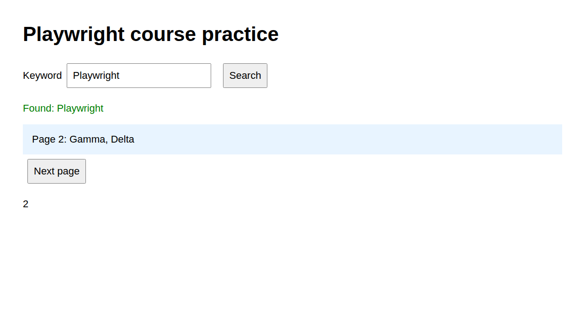

图 1 显示增量包自带的练习页，用于检查图形浏览器能否打开并交互。下图记录正式实验的运行环境，后续采集使用的是实际 QQ 邮箱。

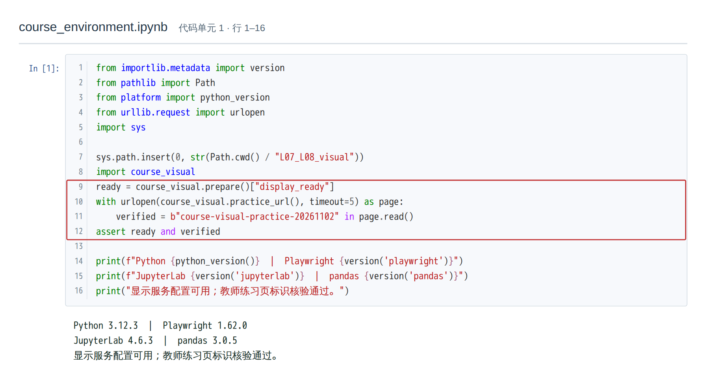

**人工扫码与程序判断（单元 2）。** 浏览器打开 QQ 邮箱后，我用手机扫码确认登录。程序在页面的各个框架内查找可见的 `.sidebar-menu-text`，完整匹配“收件箱”或“Inbox”后点击。若页面已在收件箱，则同时检查收件箱路由和第一封可见邮件。最长等待 600 秒，每 0.5 秒检查一次。

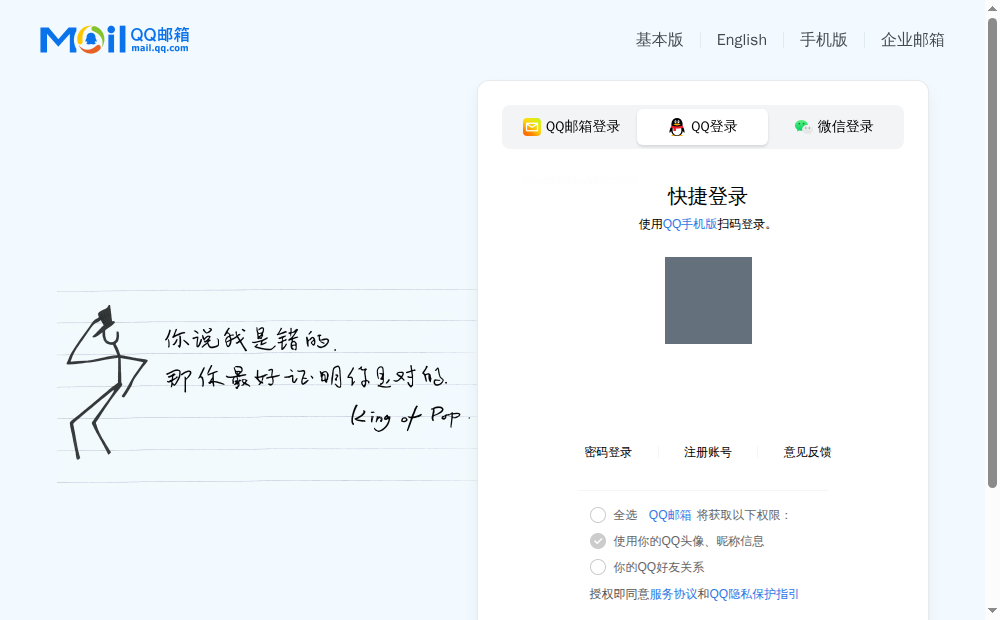

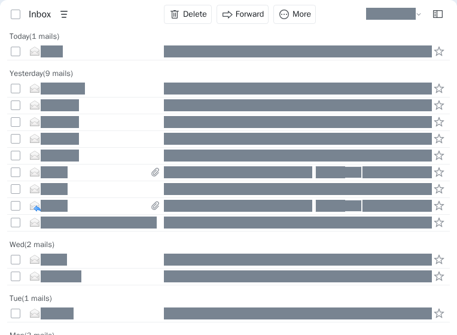

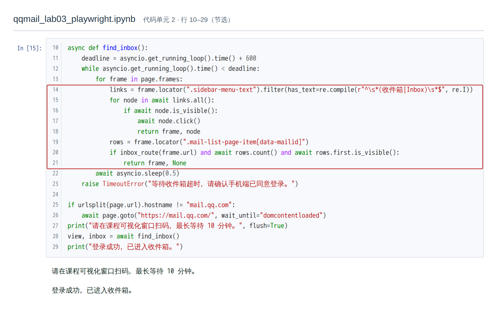

页面加载完成时，扫码可能仍未确认。收件箱控件或收件箱路由和邮件行满足条件后，单元才输出“登录成功，已进入收件箱。”下一单元也定位到了邮件行。

## 第二阶段　采集 10 封邮件并保存 CSV（第 3—4 课时）

### 字段提取（单元 3—5）

| 目标 | 页面定位 | 取值或判断方法 |
|---|---|---|
| 一封普通邮件 | `.mail-list-page-item[data-mailid]` | 读取行的 `data-mailid`，以后按这个 ID 找回同一封邮件。行内含 `.gg-unread-count` 时跳过聚合入口。 |
| 发件人 | 当前行的 `.cmp-account-nick` | 读取可见节点的 `inner_text()` 并去除首尾空白。 |
| 邮箱 | 悬停当前发件人后出现的 `.cmp-email-address` | 从卡片文字、`title` 或 `href` 中提取邮箱地址。 |
| 主题 | 当前行的 `.mail-subject` | 在该行范围内读取可见文字。 |
| 时间 | 当前行的 `.mail-time` | 按列表实际显示文字保存。 |

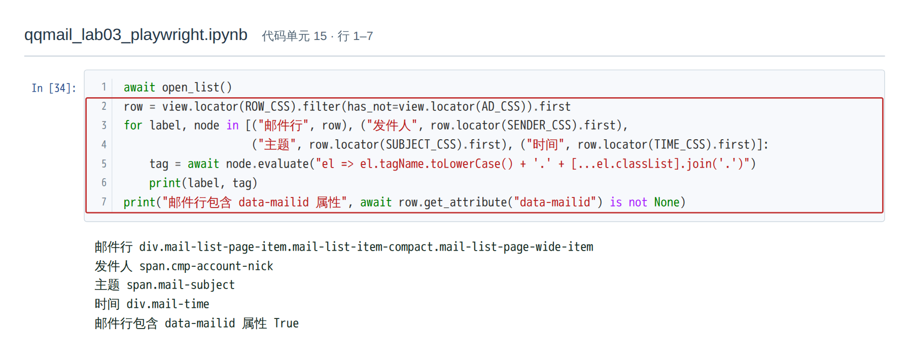

以主题为例，先在第一封邮件的父容器中找到带 `mail-subject` 类名的子节点，再写成 `row.locator(".mail-subject")`。这样即使多封邮件显示在同一屏，也只读取当前行的主题。

邮箱卡片浮在邮件行之外。程序先悬停本行的时间，让上一张卡片消失，再把当前发件人滚入视野。确认滚动结束后悬停发件人，等新卡片可见才读取地址，避免把上一封邮件的邮箱写到当前行。

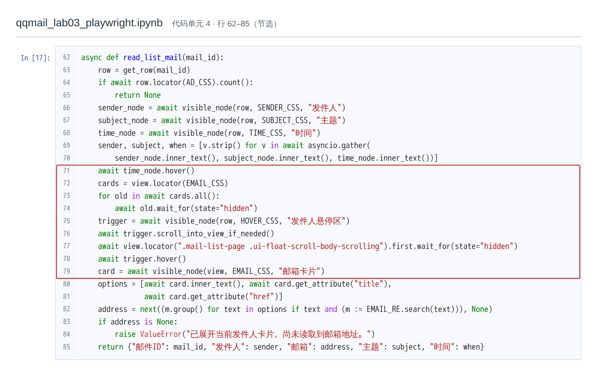

### 保存、回读与三条样本核对（单元 6）

本次成功采集 **10 封普通邮件**。按“发件人、邮箱、主题、时间”四列建立 `pd.DataFrame`，用 `to_csv(index=False, encoding="utf-8-sig")` 写入临时文件后替换正式文件。用 `pd.read_csv(dtype=str, keep_default_na=False)` 回读，得到 **10 行 × 4 列**。`index=False` 避免把行号额外写成数据列，空字段回读后保留为空字符串。

| 网页与原始 CSV 中的位置 | 发件人 | 邮箱 | 主题 | 时间 |
|---|---|---|---|---|
| 第 1 封 | 一致 | 一致 | 一致 | 一致 |
| 第 5 封 | 一致 | 一致 | 一致 | 一致 |
| 第 10 封 | 一致 | 一致 | 一致 | 一致 |

记录每封邮件所在的滚动位置，保存后恢复该位置，按 ID 重新读取网页字段，再与同一行 CSV 逐项比较。三封共 **12 项**比较全部通过。公开表保留对应关系，隐去真实字段值。

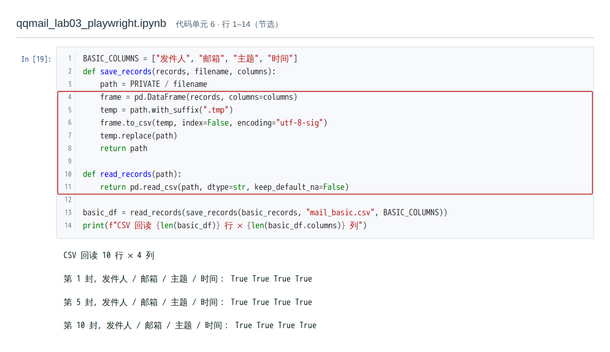

本地原始表为 `private_data/mail_basic.csv`。提交的脱敏表为 [mail_basic_public.csv](data/mail_basic_public.csv)。

## 第三阶段　滚动采集与邮件 ID 去重（第 5—6 课时）

### 滚动、等待与停止（单元 4、7）

程序定位 `.mail-list-page .ui-float-scroll-body` 作为滚动容器，用 `scrollTop` 记录当前批次的起点。下一位置为“当前起点 + 可见高度 − 8 像素”，最大到 `scrollHeight - clientHeight`。相邻两屏留出少量重叠，跨越屏幕边缘的邮件也有机会被两批同时找到。

每次设置位置后，等待两次页面绘制，再比较前后两组**实际可见**的邮件 ID。新组非空且已经变化才开始下一批。达到第 3 批或没有可向下滚动的位置时结束。若滚动后 ID 持续不变，程序报错，便于核对容器。

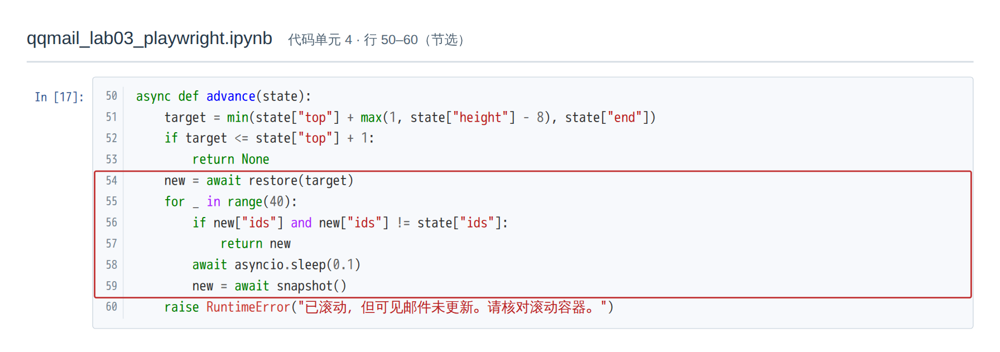

### 去重与重复采集（单元 7—9）

每次调用 `collect_batches()` 时先建一个 `seen_ids` 集合，三批都把同一集合交给 `parse_batch()`。解析前先检查 ID 是否已出现。普通邮件提取成功并追加到记录列表后，才把它的 ID 加入集合。

| 批次 | 新增唯一邮件 | 累计唯一邮件 |
|---|---:|---:|
| 第 1 批 | 13 | 13 |
| 第 2 批 | 17 | 30 |
| 第 3 批 | 17 | 47 |

**批次回读与停止原因。** 达到设定的三批后结束。CSV 回读 **47 行 × 5 列，唯一 ID 为 47 个，重复 ID 为 0 个**。五列依次为邮件 ID、发件人、邮箱、主题、时间。原始表为 `private_data/mail_pages.csv`，公开表为 [mail_pages_public.csv](data/mail_pages_public.csv)。

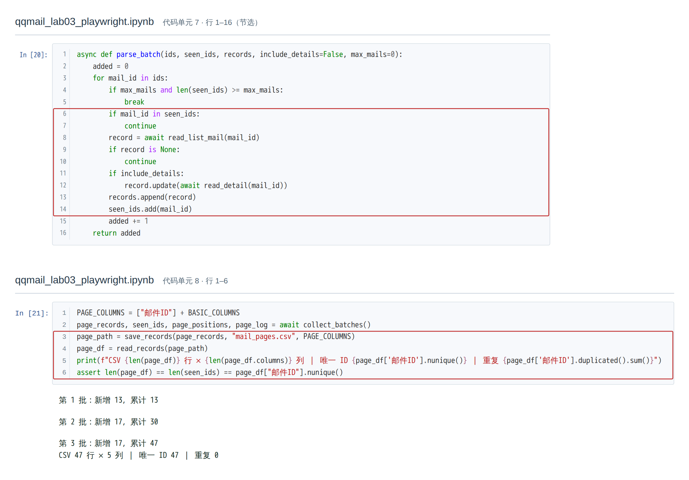

**复采验证。** 单元 9 从已采列表抽取前五个 ID，保留原来的 `seen_ids`，再次调用同一个解析函数。重采 **5 封，新增 0 封**。重新保存后逐字节比较，CSV 内容完全相同，记录数仍为 47。

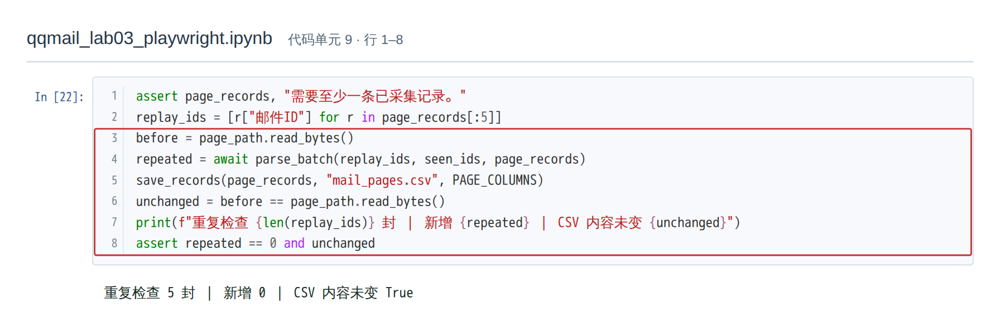

## 第四阶段　邮件详情与正文（第 7—8 课时）

### 进入详情、读取正文、返回列表（单元 10）

打开详情前保存滚动位置，按邮件 ID 找到当前行并点击 `.mail-subject`。先定位详情页内的 `.mail-detail-content`。若该区域含可见的正文 iframe，进入该框架读取 `body.inner_text()`。普通节点则读取 `.mail-detail-content > .qmbox` 的可见文字。这样不会把页面工具栏、主题栏和邮件列表混入正文。

读取完成后在 `finally` 中点击返回控件（`.xmail-ui-btn:has(+ .back-divider)`，并兼容“返回”或“Back”文字）。等邮件行重新出现，恢复之前的 `scrollTop`，再按原 ID 重新定位，继续处理下一封。

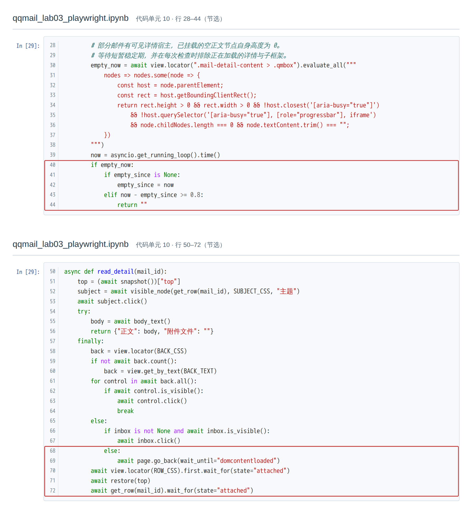

### 先试 3 封，再采集 3 批（单元 11—12）

试采表 `private_data/mail_details_trial.csv` 只在本地核对。程序重新打开这三封邮件，把当前详情可见文字与回读的正文逐字符串比较。返回后再次检查对应邮件行是否可见。

| 试采样本（列表顺序） | 正文字符数 | 详情与 CSV | 返回后原邮件行可见 |
|---|---:|---|---|
| 第 1 封 | 1180 | 一致 | 是 |
| 第 2 封 | 427 | 一致 | 是 |
| 第 3 封 | 464 | 一致 | 是 |

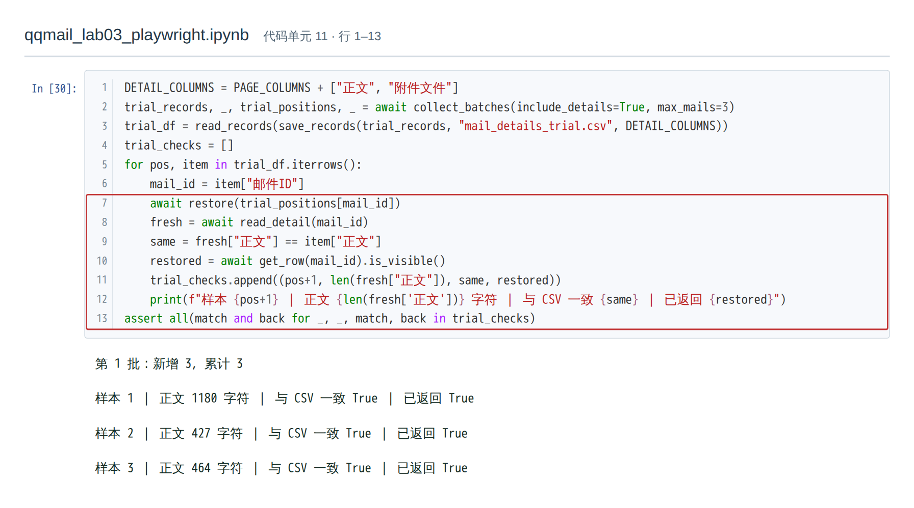

正式采集完成三批，各新增 **13、17、17 封**。正文表回读 **47 行 × 7 列**，其中 **45 封有可见正文文字，2 封可见正文为空**，空值按原样保留。47 条记录中重复 ID 为 0，邮件 ID 集合与第三阶段完全一致。

七列依次为邮件 ID、发件人、邮箱、主题、时间、正文、附件文件。原始表为 `private_data/mail_details.csv`，提交的脱敏表为 [mail_details_public.csv](data/mail_details_public.csv)。

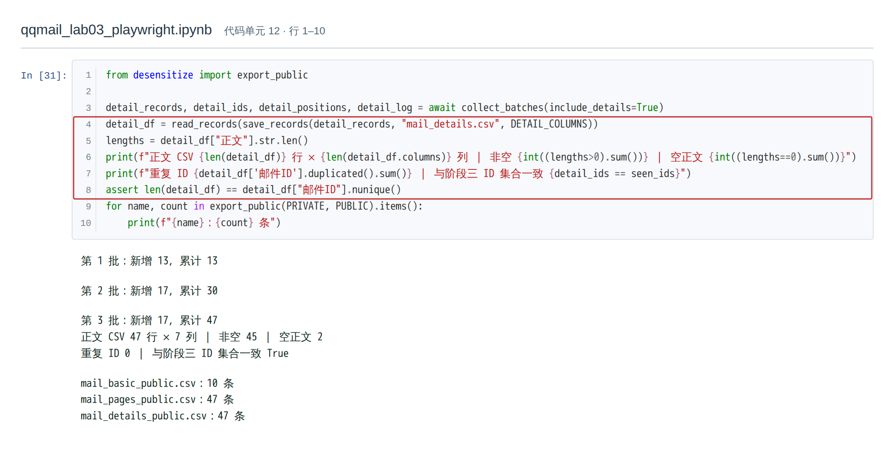

**选做项目。** 本次未选做附件下载。`DOWNLOAD_ATTACHMENTS = False`，输出保留“附件文件”列且填空值。

## 问题与解决

起初 Docker 命令能运行，但连接不上 Linux 引擎。先启动 Docker Desktop 和原课程工作区，确认 Jupyter 可用，再安装增量包。离线镜像的 SHA-256 与教师清单一致，浏览器随后成功打开课程练习页及 QQ 收件箱。

正式采集首次处理到第 7 封时，等待正文可见超时。检查页面后发现，详情正文区域已有 100 像素高，里面的 `.qmbox` 已挂载但高度为 0，文字、子节点和图片均为空，页面也没有加载标志。程序增加对这一情况的判断，要求正文区域可见、没有加载标志或子框架，且空节点持续至少 0.8 秒。修改后能继续处理下一封，最终保存了全部 47 条，其中 2 条的可见正文为空。

## 思考题

**1．人工扫码完成了什么？程序怎样判断已登录？为什么不能只等待固定秒数？**

答：手机扫码并确认，完成账号授权。程序等待可见的“收件箱”入口，或在收件箱路由中确认邮件行已显示。扫码和网络耗时会变化，固定等待太短会提前读列表，太长会让已经登录的页面空等。

**2．为什么按邮件 ID 去重？怎样验证去重确实生效？**

答：同一发件人能发送多封邮件，主题也可能重复，用这两列去重会误删。每一行的 `data-mailid` 可以识别同一封邮件。保持原集合重采已处理的 5 个 ID 后，新增 0 条，CSV 内容也未变。单独重启后覆盖文件，只能说明两次保存结果相同，无法判断程序是否跳过了已有 ID。

**3．列表摘要与正文有什么区别？返回后怎样避免漏采？**

答：摘要是列表中用于预览的片段，完整正文要进入详情后从专用内容节点读取。正文中的换行可能占多个文本行，所以用 `len(pd.read_csv(...))` 统计记录数。返回时恢复滚动位置，重新按 ID 找邮件，即使列表重绘，下一封仍可准确定位。

**4．遇到的一个实际问题怎样定位并验证？AI 协助了哪些部分？**

答：第 7 封详情里，已挂载的空正文节点高度为 0，原来的可见性条件会一直等待。修复时先确认外层正文区域已显示，再检查专用正文节点是否挂载、是否仍在加载。节点持续为空且没有加载标志时，允许保存空字符串，并返回列表继续。AI 协助补全和调试代码、检查该节点并整理脱敏证据。我在手机上完成扫码授权，报告数值来自实际 Notebook 输出。

## 提交内容与脱敏

三张公开表使用同一本地随机密钥和 HMAC-SHA256 把标识转换成代号。邮件 ID 在两张含 ID 的表中可相互核对，发件人、邮箱、主题和时间在三张表间也使用相同映射。公开正文列仅保存“正文 N 字符”，空正文保留为空值。密钥与原始 CSV 一起留在本地 `private_data/`。

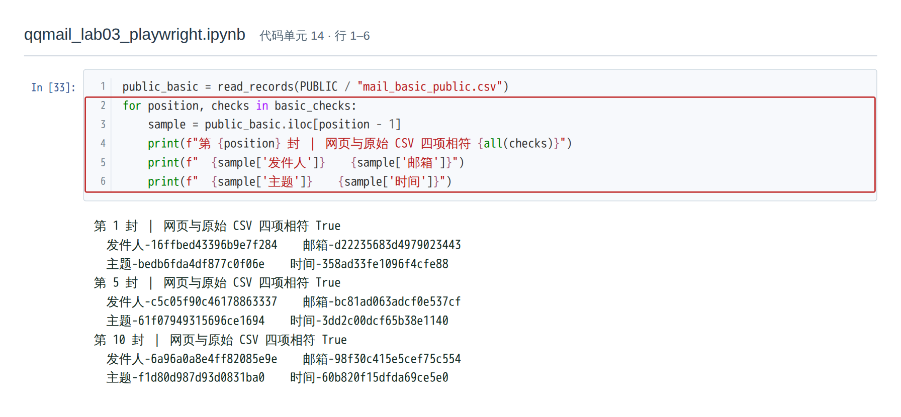

图 15 显示公开表中对应字段的代号及正文长度。原始字段与网页的核对结果见图 8，正文核对见图 13。

本次作业包括这一份四阶段报告、一个 Notebook、三份公开 CSV 和脱敏截图。学习通所需的原作业仓库链接见报告首页。
